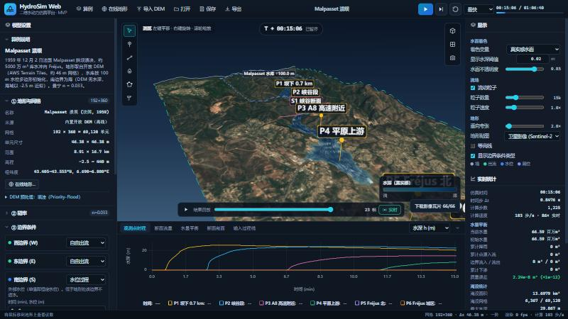
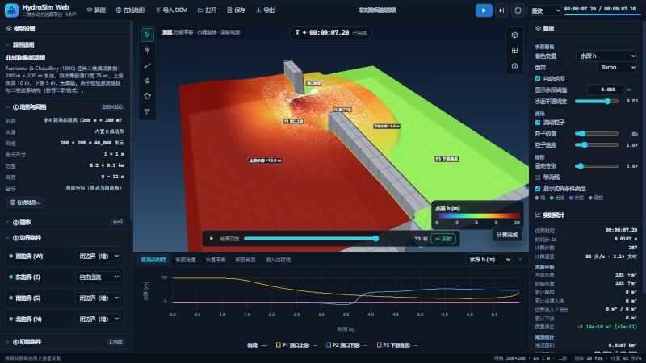
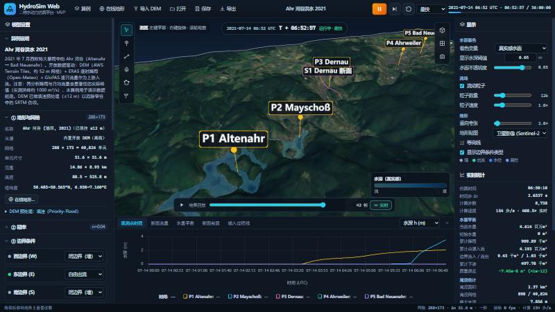
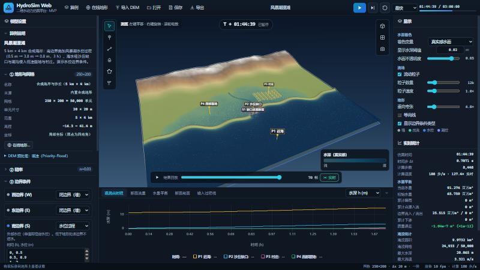
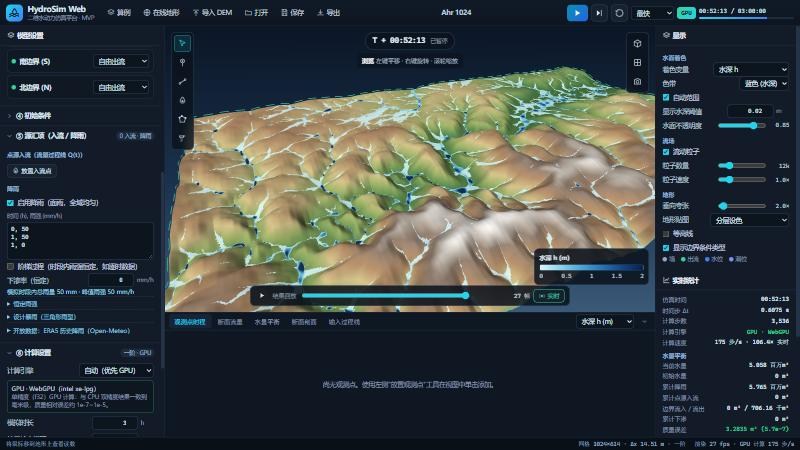
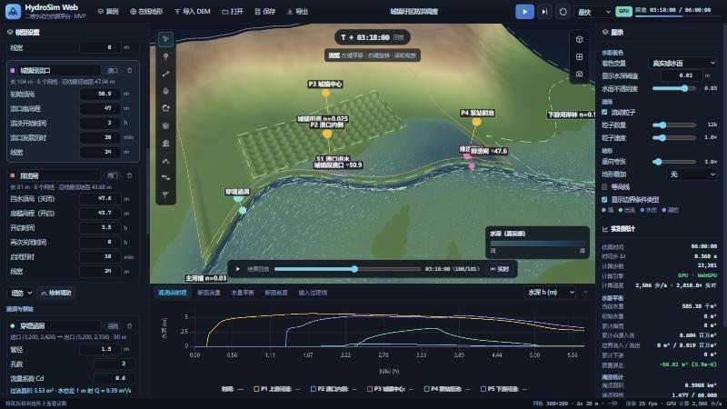
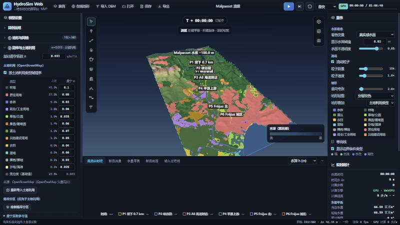

# HydroSim Web

**A browser-based 2D shallow-water hydrodynamic simulator — terrain to 3D results, with no install and no server.**

[English](README.md) · [简体中文](README.zh-CN.md)


HydroSim Web runs a finite-volume solver for the 2D shallow water equations entirely in the browser (WebGPU compute
shaders, with a double-precision CPU fallback in a Web Worker) and renders the flood in 3D with Three.js. It covers the
core workflow of packages such as HEC-RAS 2D, MIKE 21, TELEMAC-2D and TUFLOW:

**terrain → mesh → roughness / land use → buildings and hydraulic structures → boundary / initial conditions → sources and sinks → simulation → 3D visualisation and analysis**

and plugs into open data: global DEM, OpenStreetMap buildings and land use, ERA5 rainfall, GloFAS river discharge and
satellite imagery.



| Asymmetric partial dam break (benchmark) | Ahr valley 2021 (ERA5 rain + GloFAS inflow) |
|---|---|
|  |  |
| **Storm-surge overtopping (water-level boundary)** | **Online DEM rainfall-runoff · maximum depth envelope** |
|  |  |



| Polder flood-defence operation (buildings · breach · gate · culvert · pump) | OpenStreetMap land-use roughness (Malpasset / Fréjus) |
|---|---|
|  |  |

## Quick start

Requires Node.js ≥ 22 (developed on v24).

```bash
npm install
npm run dev
```

Open <http://127.0.0.1:5173>. The default case is the valley flood; use e.g. `?case=malpasset` to open a specific case.

```bash
npm test          # unit tests (Vitest)
npm run build     # type-check, then build a static site into dist/
```

The build is a static site and can be hosted anywhere. This repository ships a GitHub Pages workflow
([.github/workflows/pages.yml](.github/workflows/pages.yml)).

WebGPU validation / benchmark page (dev server): <http://127.0.0.1:5173/gpu-test.html> with `?run=basic`, `?run=parity`,
`?run=structures` or `?run=bench` compares the GPU engine with the CPU double-precision engine case by case and times it.

## Features

**Pre-processing**
- Terrain: built-in synthetic terrain; **online open DEM** (draw a box on the map → AWS Terrain Tiles are downloaded and resampled to the grid); **ESRI ASCII Grid (.asc)** import; **depression filling** (Priority-Flood)
- Roughness: base Manning *n* + **OpenStreetMap land-use classes** (13 editable classes) + **hand-drawn roughness zones** (priority: zone > land use > base); edits apply live while running
- **Buildings**: import outlines and heights from OpenStreetMap or draw them; treated either as **blocking blocks** (cells ≥ 50 % covered are raised) or as **high roughness** (Manning *n* blended by coverage — for coarse grids)
- **Hydraulic structures** (polyline / two-point tools; identical results on CPU and GPU engines): levees, weirs, **gates** (timed opening/closing), **breaches** (linear erosion over a development time), **culverts** (orifice equation, bidirectional, multi-barrel) and **pumps** (discharge hydrograph with automatic throttling when the intake runs dry)
- Boundary conditions per side: wall, free outflow, stage hydrograph, sinusoidal tide
- Initial conditions: uniform water level, **interactive water polygons** (reservoir / dam break)
- Sources and sinks: point inflow hydrographs (constant / triangular / custom / **GloFAS**), areal rainfall (constant / design storm / custom / **ERA5**) with constant infiltration
- Run settings: duration, output interval, 1st/2nd order, CFL, max step, wet/dry threshold

**Solver**
- Finite-volume Godunov scheme with HLL Riemann solver and **Chen–Noelle hydrostatic reconstruction** (well-balanced, positivity-preserving)
- Optional second order (MUSCL with minmod + Heun), fully implicit Manning friction, CFL-adaptive time step, parameters editable while running
- **Two compute engines** (switchable, GPU preferred by default):
  - **GPU · WebGPU** (`src/gpu/`): WGSL compute shaders with time stepping, source integration and gauge recording all on the GPU. Depth differs from the CPU engine by ≤ 0.3 mm with identical wet cells, and is **22–46× faster** (Intel integrated GPU); million-cell grids are feasible
  - **CPU · Web Worker** (`src/core/solver.ts`): double-precision reference implementation, used automatically when WebGPU is unavailable
- Mass-balance audit (rain / inflow / infiltration / boundary flux / error): ~1e-15 on CPU, ~1e-7–1e-5 on GPU

**Post-processing and visualisation**
- 3D terrain (hypsometric tint + hillshade / satellite / OSM texture, contours, vertical exaggeration)
- Animated water surface (Fresnel, specular, flow ripples, whitewater) or colour by depth, speed, stage, Froude number, hazard h(V+0.5), **maximum depth / speed / hazard envelopes**, **arrival time**
- Flow particles, legends, hover read-out; gauge hydrographs, cross-section discharge, mass balance, profiles and input-series charts (uPlot)
- Result-frame recording with **timeline playback** (auto-thinned to a memory budget); interactive "pour water" tool

**Export and projects**
- PNG screenshot; CSV for gauges / sections / mass balance; ASCII raster export (depth, stage, speed, maxima, arrival time, terrain — with EPSG:3857 georeferencing for online DEMs)
- Project files (`.hydrosim.json`) containing the original DEM, imported buildings / land-use rasters and all settings

## Built-in cases

| Group | Case | Notes |
|---|---|---|
| Benchmark | Asymmetric partial dam break | Fennema & Chaudhry (1990), 2D shock |
| Benchmark | Three-hump dam break | Kawahara & Umetsu / Brufau et al., wet/dry front |
| Benchmark | Thacker parabolic basin | analytic solution, moving shoreline |
| Synthetic | Valley flood routing | triangular hydrograph, floodplain, levees, town (default) |
| Synthetic | Polder flood-defence operation | 136 buildings, roughness zones, levees; culvert backflow, breach at 2.0 h, pump from 2.5 h, gate drainage at 3.5 h |
| Synthetic | Storm-surge overtopping | stage boundary, dune gap |
| Real terrain | Malpasset dam break (France, 1959) | offline-bundled open DEM, 100 m reservoir polygon |
| Real terrain | Ahr valley flood (Germany, 2021) | open DEM + hourly ERA5 rain + daily GloFAS discharge (offline copy) |

All built-in cases run offline; online terrain and ERA5 / GloFAS retrieval need a network connection.

## Open data sources

| Data | Source | Licence / attribution |
|---|---|---|
| Global DEM (incl. bathymetry) | [AWS Open Data · Terrain Tiles](https://registry.opendata.aws/terrain-tiles/) (Terrarium encoding) | SRTM, GMTED2010, ETOPO1, NED … per Tilezen/joerd attribution |
| Historical rainfall | [Open-Meteo Historical Weather API](https://open-meteo.com/en/docs/historical-weather-api) (ERA5 / ERA5-Land) | CC BY 4.0 |
| River discharge | [Open-Meteo Flood API](https://open-meteo.com/en/docs/flood-api) (Copernicus GloFAS v4) | CC BY 4.0 |
| Satellite imagery | EOX Sentinel-2 cloudless 2016 | CC BY 4.0 |
| Base map | OpenStreetMap | ODbL, follow the tile usage policy |
| Buildings and land use | OpenStreetMap via [OpenFreeMap](https://openfreemap.org) vector tiles (OpenMapTiles, z14) | ODbL: © OpenStreetMap contributors · OpenMapTiles |

All APIs allow CORS so the browser talks to them directly. Building / land-use import needs a georeferenced terrain
(online DEM or a real-terrain case) and is limited to roughly 400 km² per request. Full attribution:
[NOTICE.md](NOTICE.md). `scripts/fetch-dem.mjs` packs any region into an offline case:

```bash
node scripts/fetch-dem.mjs --name mysite --bbox 103.55,30.97,103.67,31.04 --cells 256 --title "My site" --out public/data/mysite.json
```

## Usage tips

- View: left-drag pans, right-drag rotates, wheel zooms; Space runs / pauses; Esc leaves the current tool.
- The left "Model" panel is organised ①–⑧. Boundaries, roughness, culverts / pumps, sources and numerical parameters can be changed while running; initial conditions, buildings and structure lines (which rewrite the computational terrain) reset the simulation.
- Toolbar: gauges, cross-sections (discharge positive to the right of start→end), inflow points, water polygons, roughness zones, building outlines, structure lines, culverts / pumps (click intake then outlet), pour water. Double-click or Enter finishes a polygon / polyline.
- On grids coarser than 15 m use the "high roughness" building mode; "blocking blocks" need streets at least one cell wide.
- For real DEMs use 128–384 cells; the open DEM is ~30 m native, finer grids add no detail.
- If spurious ponding appears in narrow valleys, run depression filling under "① Terrain & grid → DEM pre-processing".

## Project layout

```
hydrosim-web/
├─ docs/DESIGN.md          design document (feature comparison, architecture, numerics, data, validation, roadmap; Chinese)
├─ public/data/            offline-bundled open data (Malpasset / Ahr DEM, Ahr rainfall and discharge)
├─ scripts/fetch-dem.mjs   DEM packing script
├─ src/
│  ├─ core/                solver (roughness field, structure lines, culverts / pumps), rasterisation, hydrographs, analytic solutions, geometry, depression filling — DOM-free and unit-tested
│  ├─ gpu/                 WebGPU engine: WGSL compute shaders, batched dispatch, GPU-side recording ring buffer
│  ├─ worker/              compute Worker, engine interface and CPU engine, message protocol
│  ├─ dev/                 WebGPU validation and benchmark page (gpu-test.html)
│  ├─ data/                DEM tiles, imagery, ASC, Open-Meteo, OSM vector tiles, synthetic terrain, built-in cases
│  ├─ viz/                 Three.js scene, terrain (with overlays), water, particles, markers, picking, colormaps
│  ├─ ui/                  top bar, model panel, display panel, chart dock, map picker, viewport overlays
│  ├─ model.ts             model input builder: effective terrain, Manning field, structures
│  ├─ app.ts               application controller (state, tools, result store, Worker comms)
│  └─ io.ts                export and project files
└─ tests/                  Vitest unit tests (the GPU engine is validated in-browser via gpu-test.html)
```

## Engine performance (Intel Xe-LPG integrated GPU, Chrome 156)

| Grid | CPU engine (steps/s) | GPU engine (steps/s) | Speed-up |
|---|---|---|---|
| 256×256, 1st order | 92 | 2435 | 26× |
| 256×256, 2nd order | 34 | 1117 | 33× |
| 512×512, 1st order | 25 | 800 | 32× |
| 1024×1024, 1st / 2nd order | — | 212 / 70 | — |

The full Malpasset dam break (4000 s) finishes in about 5 s on the GPU (~890× real time).

## Known limitations

- Uniform structured grid only; the CPU engine slows down beyond ~500k cells, and the GPU engine on an integrated GPU manages ~200 steps/s at 1M cells (memory-bandwidth bound).
- The GPU engine is single precision: millimetre agreement with the CPU engine, relative mass error ~1e-5 for long rainfall runs; point sources must be non-negative.
- Each frame is read back from the GPU for WebGL rendering (~12 MB/frame at 1M cells); a WebGPU renderer sharing buffers is future work.
- Structures are grid-aligned "z-lines": weirs and gates are resolved by the shallow-water equations themselves (no empirical weir / gate formulas), so accuracy depends on cell size; gates follow a fixed schedule (no level-based rules); culverts use a simplified orifice formula (no pipe friction, no flap gates); sources, culverts and pumps transfer mass but not momentum.
- OSM land-use coverage is incomplete in some regions (base roughness is used there); Manning *n* does not vary with depth.
- ERA5 / GloFAS are coarse reanalysis / model data and substantially underestimate local extreme rain and flood peaks — they demonstrate the data chain only.
- Open DEMs contain no river-channel bathymetry; sea depth is approximated by a constant where no bathymetry exists.
- This is a research and demonstration tool, **not validated for engineering design or flood-risk decisions**.

See [docs/DESIGN.md](docs/DESIGN.md) for design details and [CONTRIBUTING.md](CONTRIBUTING.md) to get involved.

## License

[MIT](LICENSE) for the source code. Bundled and fetched data keeps its original licences — see [NOTICE.md](NOTICE.md).
