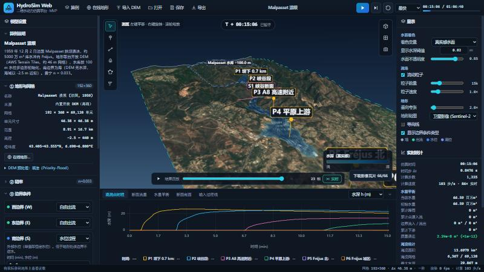
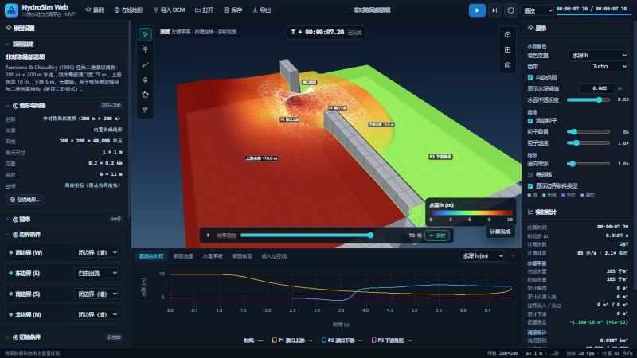
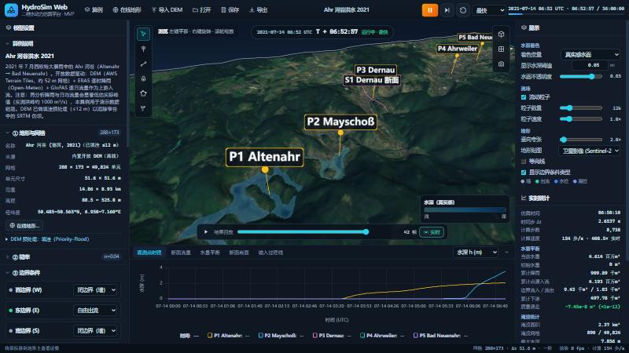
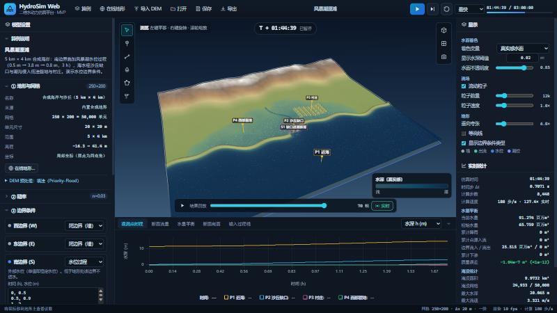
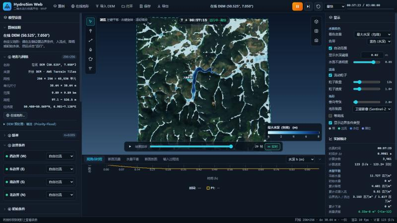
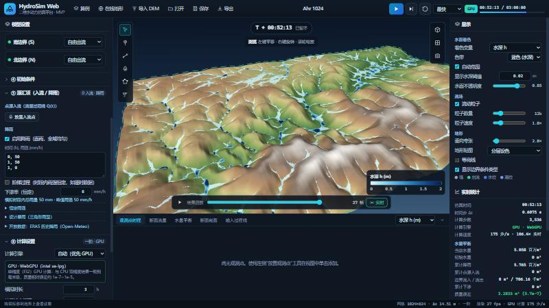
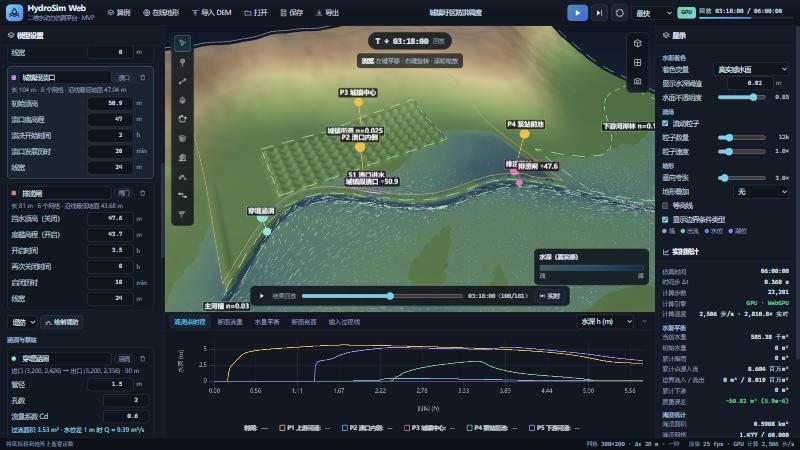
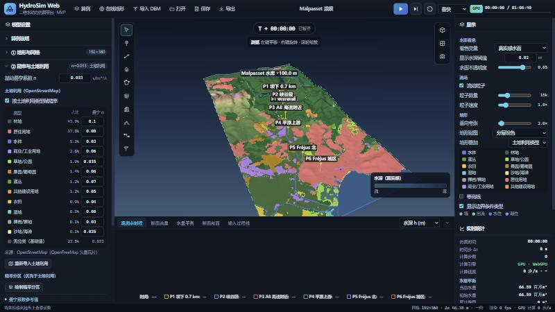
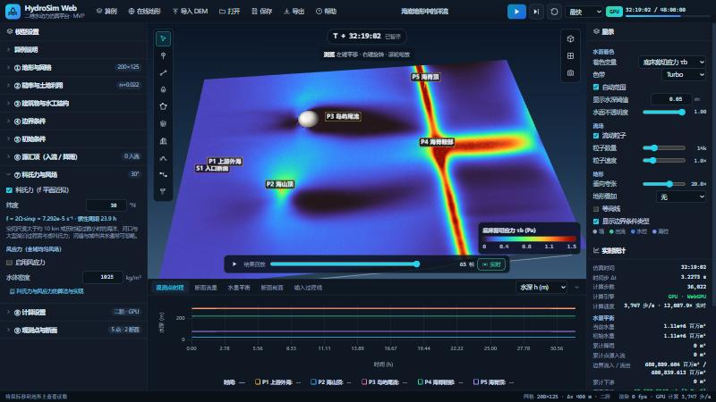
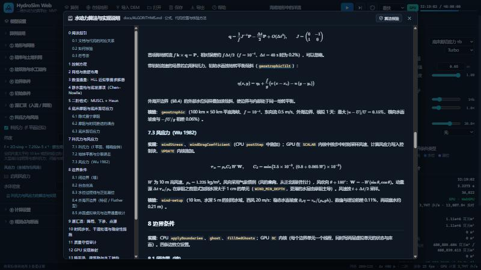

# HydroSim Web · 二维水动力仿真平台

[English](README.md) · [简体中文](README.zh-CN.md)


基于 **Three.js + WebGPU + Web Worker + TypeScript** 的浏览器端二维浅水方程水动力仿真软件。
覆盖通用水动力软件（HEC-RAS 2D、MIKE 21、TELEMAC-2D、TUFLOW 等）的核心工作流：
**地形 → 网格 → 糙率/土地利用 → 建筑物与水工结构 → 边界/初始条件 → 源汇项 → 计算 → 三维可视化与结果分析**，
并接入开放数据（全球 DEM、OpenStreetMap 建筑物与土地利用、ERA5 降雨、GloFAS 河道流量、卫星影像）。



| 非对称局部溃坝（基准） | Ahr 河谷 2021（ERA5 降雨 + GloFAS 入流） |
|---|---|
|  |  |
| **风暴潮漫滩（水位边界）** | **在线 DEM 降雨产流 · 最大水深包络** |
|  |  |



| 城镇圩区防洪调度（建筑物阻水 · 溃口 · 闸 · 涵 · 泵） | OpenStreetMap 土地利用糙率（Malpasset / Fréjus） |
|---|---|
|  |  |
| **海底地形中的洋流（海山 · 岛屿 · 海脊；科氏力 · 底床剪切应力）** | **应用内算法文档（公式、代码位置与核验方法）** |
|  |  |

## 快速开始

需要 Node.js ≥ 22（开发时使用 v24）。

```bash
npm install
```

```bash
npm run dev
```

浏览器打开 <http://127.0.0.1:5173>（默认加载"河谷洪水演进"算例；也可用 `?case=malpasset` 等参数直接打开指定算例）。

```bash
npm test
```

```bash
npm run build
```

`npm run build` 先做 TypeScript 类型检查，再输出静态站点到 `dist/`（可部署到任意静态托管）。

WebGPU 引擎验证/基准页：开发模式下打开 <http://127.0.0.1:5173/gpu-test.html>（参数 `?run=basic`、`?run=parity`、`?run=structures` 或 `?run=bench`），
在本机 GPU 上与 CPU 双精度引擎逐算例对比并测速。

## 功能一览

**前处理**
- 地形：内置合成地形；**在线开放 DEM**（地图框选 → 自动下载 AWS Terrain Tiles 并重采样到计算网格）；导入 **ESRI ASCII Grid (.asc)**；**填洼预处理**（Priority-Flood）
- 糙率：基础曼宁 n + **OpenStreetMap 土地利用**分类糙率（林地/农田/草地/居住用地等 13 类，可逐类修改）+ **手绘糙率分区**（优先级：分区 > 土地利用 > 基础值）；运行中修改即时生效
- **建筑物**：从 OpenStreetMap 导入建筑物轮廓与高度，或手绘轮廓；两种处理方式：**阻水块**（覆盖 ≥ 50% 的网格抬高建筑高度，水流绕行）或 **高糙率**（按网格内建筑覆盖率混合曼宁 n，适合粗网格）
- **水工结构**（折线/两点绘制，CPU 与 GPU 引擎结果一致）：
  - **堤防**（地面抬高到堤顶）、**堰**（地面设为堰顶），网格化为 4 连通线，不会从对角漏水
  - **闸门**：按时间开启/再关闭，挡水顶高与底槛之间线性启闭
  - **溃口**：自溃决时刻起在发展历时内由顶高线性冲刷至溃口底（可作用于 DEM 中已有的堤）
  - **涵洞**：孔口公式 Q = Cd·A·√(2gΔH)，按水位差双向过流（多孔、管径、流量系数）
  - **泵站**：按流量过程线由取水点抽至排水点，取水点水量不足时自动减抽
- 地形叠加显示：曼宁糙率场、土地利用类型、建筑物覆盖率（含图例）
- 边界条件（四边独立）：闭边界、自由出流（坡面出口按正常水深假定）、水位过程线、正弦潮位、**外海开边界**（外海水位 + 流速作为边界黎曼问题的远场状态，特征 / Flather 型，向外传播的波无反射）
- 初始条件：全域初始水位、**交互绘制水体多边形**（水库/溃坝）、**均匀初始流速**（启用科氏力时水面自动按地转平衡倾斜）
- **大尺度物理过程**：**科氏力**（f 平面，逐步精确旋转）、**风应力**（全域均匀风速过程与风向，Wu 1982 拖曳系数）、水体密度（淡水/海水）
- 源汇项：点源入流过程线（恒定/三角形/自定义/**GloFAS**），面降雨（恒定/三角形设计暴雨/自定义/**ERA5**）+ 恒定下渗
- 计算设置：时长、输出间隔、一阶/二阶格式、CFL、最大步长、干湿阈值

**求解器**
- 有限体积 Godunov 格式，HLL 黎曼求解器 + **Chen–Noelle 静水重构**（静水和谐、非负、陡坡薄层精度好）
- 可选二阶：MUSCL（minmod）+ Heun，隐式曼宁摩阻在每一级内施加（均匀流为离散格式的精确不动点）；CFL 自适应步长；运行中可热修改参数
- **两套计算引擎**（在"⑧ 计算设置"中切换，默认自动优先 GPU）：
  - **GPU · WebGPU**（`src/gpu/`）：同一格式的 WGSL 计算着色器；时间步长、源项积分、观测记录全部在 GPU 上完成。
    与 CPU 引擎逐算例对比，水深差异 ≤ 0.3 mm、湿润网格完全一致，**比 CPU 快 22–46 倍**（Intel 核显实测），可计算百万级网格
  - **CPU · Web Worker**（`src/core/solver.ts`）：双精度参考实现；浏览器不支持 WebGPU 时自动回退
- 水量平衡审计：降雨/入流/下渗/边界进出/质量误差（CPU 双精度约 1e-15；GPU 单精度约 1e-7~1e-5）

**后处理与可视化**
- 三维地形（分层设色 + 山体阴影 / 卫星影像 / OSM 贴图、等高线、垂向夸张）
- 动态水面：真实感渲染（菲涅尔、高光、随流波纹、急流白沫）或按变量着色：水深、流速、水位、弗劳德数、危险度 h(V+0.5)、**底床剪切应力 τb**、**最大水深/最大流速/最大危险度包络**、**淹没到达时间**
- 流动粒子、图例、悬停读数（坐标/经纬度、地面高程、水深、水位、流速、Fr、τb）
- 观测点时程、断面流量、水量平衡、断面剖面、输入过程线图表（uPlot）
- 结果帧记录与**时间轴回放**（内存预算自动抽稀）
- 交互"注水"工具：按住鼠标向地形注水，实时观察汇流

**导出与工程**
- PNG 截图；观测点/断面/水量平衡 CSV；栅格 .asc（当前水深/水位/流速/底床剪切应力、最大水深/流速/危险度、到达时间、地形；在线 DEM 结果带 EPSG:3857 坐标）
- 工程文件保存/打开（`.hydrosim.json`，含原始 DEM、导入的建筑物/土地利用栅格与全部设置）

## 算法文档与核验

[docs/ALGORITHMS.md](docs/ALGORITHMS.md) 逐项说明求解器用到的全部算法：控制方程、离散公式、实现该算法的 CPU 函数与 GPU 内核、
以及对应的核验算例和通过阈值。应用中"帮助 → 算法与实现文档"以带公式的形式显示同一文档，模型面板各节的 📖 链接直接跳到对应章节；
"帮助 → 算法核验"在后台线程运行 14 个核验算例（静水和谐、Ritter/Stoker 溃坝、质量守恒、降雨产流、曼宁正常水深、Thacker 盆地、
惯性振荡、地转平衡、风壅水、外海边界无反射与入流、涵洞孔口公式、CPU/GPU 一致性），显示指标、阈值、结论和数值解与解析解的对比曲线。
`npm test` 使用同一套算例与阈值（[tests/verify.test.ts](tests/verify.test.ts)）。

## 内置算例

| 分组 | 算例 | 说明 |
|---|---|---|
| 基准验证 | 非对称局部溃坝 | Fennema & Chaudhry (1990)，二维激波 |
| 基准验证 | 三驼峰溃坝 | Kawahara & Umetsu / Brufau 等，干湿前沿 |
| 基准验证 | Thacker 抛物面盆地 | 解析解，岸线往复移动 |
| 合成场景 | 河谷洪水演进 | 三角形洪水过程线、漫滩、堤防、城镇（默认算例） |
| 合成场景 | 城镇圩区防洪调度 | 136 栋建筑阻水、糙率分区、沿河堤防与横堤围成圩区；涵洞倒灌、2.0 h 溃口、2.5 h 泵站抽排、3.5 h 排涝闸回排 |
| 合成场景 | 海底地形中的洋流 | 80 km × 50 km 海域，0.4 m/s 外海流经过海山、岛屿与带鞍部的海脊；北纬 30° 科氏力、地转平衡初始场、外海开边界、底床剪切应力 |
| 合成场景 | 风暴潮漫滩 | 南边界风暴潮水位过程，沙丘缺口进潮 |
| 真实地形 | Malpasset 溃坝（法国 1959） | 开放 DEM（离线打包），水库多边形 100 m 水位 |
| 真实地形 | Ahr 河谷洪水（德国 2021） | 开放 DEM + ERA5 逐时降雨 + GloFAS 日流量（离线打包副本） |

内置算例全部可离线运行；"在线地形"与 ERA5/GloFAS 获取需要联网。

## 开放数据源

| 数据 | 来源 | 许可 / 署名 |
|---|---|---|
| 全球 DEM（含海底地形） | [AWS Open Data · Terrain Tiles](https://registry.opendata.aws/terrain-tiles/)（Terrarium 编码） | SRTM、GMTED2010、ETOPO1、NED 等，按 Tilezen/joerd 署名 |
| 历史降雨 | [Open-Meteo Historical Weather API](https://open-meteo.com/en/docs/historical-weather-api)（ERA5 / ERA5-Land） | CC BY 4.0 |
| 河道流量 | [Open-Meteo Flood API](https://open-meteo.com/en/docs/flood-api)（Copernicus GloFAS v4） | CC BY 4.0 |
| 卫星影像 | EOX Sentinel-2 cloudless 2016 | CC BY 4.0 |
| 底图 | OpenStreetMap | ODbL，遵守瓦片使用政策 |
| 建筑物与土地利用 | OpenStreetMap，经 [OpenFreeMap](https://openfreemap.org) 矢量瓦片（OpenMapTiles 架构，z14） | ODbL：© OpenStreetMap contributors · OpenMapTiles |

所有接口均支持 CORS，浏览器直接访问。建筑物/土地利用导入需要地理坐标地形（在线 DEM 或真实地形算例），单次约 400 km² 以内。`scripts/fetch-dem.mjs` 可把任意区域的 DEM 打包为离线算例：

```bash
node scripts/fetch-dem.mjs --name mysite --bbox 103.55,30.97,103.67,31.04 --cells 256 --title "我的区域" --out public/data/mysite.json
```

## 使用提示

- 视图操作：左键平移、右键旋转、滚轮缩放；空格键 运行/暂停；Esc 退出当前工具。
- 左侧"模型设置"按 ①–⑨ 顺序配置；修改边界、糙率、涵洞/泵站、源汇项、科氏力与风、数值参数可在运行中即时生效；修改初始条件、建筑物或结构线（会改写计算地形）会重置模拟。
- 视窗左侧工具条：观测点、断面（流量以 起点→终点 方向的右侧为正）、入流点、水体多边形、糙率分区、建筑物轮廓、结构线（类型在"③"中选择）、涵洞/泵站（先点进口再点出口）、注水；多边形与折线双击或回车结束。
- 网格较粗（> 15 m）时建筑物建议用"高糙率"方式；"阻水块"需要街道至少一个网格宽。
- 真实 DEM 建议网格 128–384；开放 DEM 原始分辨率约 30 m，更细网格不会增加地形细节。
- 窄河谷中出现异常积水时，可在"① 地形与网格 → DEM 预处理"中执行填洼。

## 目录结构

```
hydrosim-web/
├─ docs/ALGORITHMS.md      水动力算法与实现说明（公式、代码位置、核验方法；应用内可查看）
├─ docs/DESIGN.md          MVP 设计文档（功能对标、架构、数值方法、数据源、验证、路线图）
├─ public/data/            离线打包的开放数据（Malpasset / Ahr DEM、Ahr 降雨与流量）
├─ scripts/fetch-dem.mjs   开放 DEM 打包脚本
├─ src/
│  ├─ core/                求解器（含糙率场、结构线、涵洞/泵站、科氏力、风应力、外海边界）、派生量、栅格化、过程线、解析解、几何、填洼（无 DOM 依赖，可单测）
│  ├─ gpu/                 WebGPU 引擎：WGSL 计算着色器、批量调度、GPU 端记录环形缓冲
│  ├─ worker/              计算 Worker（异步引擎循环）、引擎接口与 CPU 引擎、消息协议
│  ├─ dev/                 WebGPU 引擎验证与基准页（gpu-test.html）
│  ├─ data/                DEM 瓦片、影像、ASC、Open-Meteo、OSM 矢量瓦片、合成地形、内置算例
│  ├─ viz/                 Three.js 场景、地形（含叠加层）、水面、粒子、标注、拾取、色带
│  ├─ verify/              核验算例（应用内核验与 Vitest 共用）
│  ├─ ui/                  顶栏、模型面板、显示面板、图表停靠区、地图选区、视窗叠加层、算法文档查看器、核验对话框
│  ├─ model.ts             模型输入构建：有效地形、曼宁场、结构线与涵洞/泵站
│  ├─ app.ts               应用控制器（状态、工具、结果存储、Worker 通信）
│  └─ io.ts                导出与工程文件
└─ tests/                  Vitest 单元测试与核验算例（51 项；GPU 引擎在浏览器中验证）
```

## 计算引擎性能（Intel Xe-LPG 核显，Chrome 156）

| 网格 | CPU 引擎（步/秒） | GPU 引擎（步/秒） | 加速比 |
|---|---|---|---|
| 256×256，一阶 | 92 | 2435 | 26× |
| 256×256，二阶 | 34 | 1117 | 33× |
| 512×512，一阶 | 25 | 800 | 32× |
| 1024×1024，一阶 / 二阶 | — | 212 / 70 | — |

完整 Malpasset 溃坝过程（4000 s）在 GPU 上约 5 秒算完（约 890 倍实时）。

## 已知限制

- 均匀结构网格；CPU 引擎超过约 50 万单元时变慢，GPU 引擎在核显上 100 万单元约每秒 200 步（受显存带宽限制）。
- GPU 引擎为单精度：结果与 CPU 双精度一致到毫米级，长时间降雨产流的质量相对误差约 1e-5；点源仅支持非负流量。
- 每帧需把 GPU 结果读回再交给 WebGL 渲染（百万网格约 12 MB/帧）；后续可改用 WebGPU 渲染器直接共享缓冲。
- 水工结构以网格对齐的"z 线"表达：堰、闸的过流由浅水方程直接求解（不使用堰流/闸孔出流经验公式），精度取决于网格尺寸；
  闸门按预定时间启闭（尚无按水位的调度规则）；涵洞为简化孔口公式（无管道摩阻、无拍门）；点源、涵洞、泵站只转移质量不传递动量。
- 无水平紊动黏性模型（如 Smagorinsky），尾流与涡旋依赖格式的数值耗散；科氏力为 f 平面近似（无 β 效应），风场为全域均匀。完整清单见 [docs/ALGORITHMS.md](docs/ALGORITHMS.md) §16。
- 土地利用糙率取自 OpenStreetMap，覆盖不完整的地区按基础糙率处理；曼宁 n 不随水深变化。
- ERA5/GloFAS 为粗分辨率再分析/模型数据，会显著低估局地极端暴雨与洪峰，仅用于演示数据链路。
- 开放 DEM 不含河道水下地形（建筑物可从 OSM 导入）；海域水深在无测深数据处以常数近似。
- 本工具为研究与演示用途，**未经工程设计或防洪风险决策所需的验证**。

更多设计细节见 [docs/DESIGN.md](docs/DESIGN.md)，参与贡献见 [CONTRIBUTING.md](CONTRIBUTING.md)。

## 许可

源代码采用 [MIT](LICENSE) 许可；内置与在线获取的数据保持其原始许可，详见 [NOTICE.md](NOTICE.md)。
