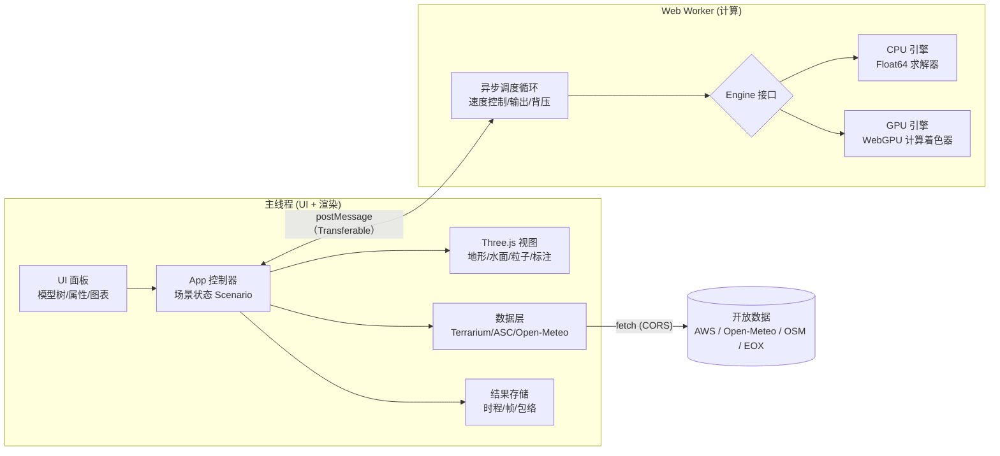

# HydroSim Web — 二维水动力仿真 Web 应用 MVP 设计文档

> 版本：v0.3（MVP + WebGPU 引擎 + 糙率分区/建筑物/水工结构） ・ 技术栈：TypeScript + Three.js + WebGPU + Web Worker ・ 文档语言：中文

## 1. 目标与范围

在浏览器中实现一个"开箱即用"的二维浅水方程（2D Shallow Water Equations, SWE）水动力仿真平台，覆盖通用水动力软件
（HEC-RAS 2D、MIKE 21、TELEMAC-2D、TUFLOW、Delft3D-FM、InfoWorks ICM 等）最核心的工作流：

```
前处理（地形 → 网格 → 糙率 → 边界/初始条件 → 源汇项）
  → 计算（有限体积 Godunov 格式，干湿处理，自适应时间步）
  → 后处理（3D 动态渲染、结果着色、观测点/断面时程、包络图、导出）
```

MVP 的原则：**数值内核正确可验证、工作流完整、数据可获取、交互直观**。GPU 求解（v0.2）与糙率分区、建筑物、
水工结构（v0.3）已在 MVP 之后加入；非结构网格、泥沙/水质等放入路线图。

## 2. 通用水动力软件功能对标

| 功能模块 | 通用软件中的典型能力 | MVP（本版本） | 后续版本 |
|---|---|---|---|
| 地形/水深 | DEM/散点/断面导入、地形编辑 | 在线开放 DEM（AWS Terrain Tiles）按地图框选加载；ESRI ASCII Grid (.asc) 导入；内置合成地形 | GeoTIFF、散点插值、地形编辑（堤防/开挖） |
| 网格 | 结构/非结构/嵌套网格 | 均匀笛卡尔网格，分辨率可选 | 非结构三角网格、局部加密 |
| 糙率 | 曼宁 n 分区/土地利用映射 | 逐网格曼宁场：基础 n + OpenStreetMap 土地利用分类映射（13 类可调）+ 多边形分区；建筑物高糙率混合 | 栅格土地利用（ESA WorldCover）、随水深变化的 n |
| 边界条件 | 流量过程、水位过程、潮位、自由出流、闭边界 | 闭边界(墙)、自由出流、水位过程线、正弦潮位 | 边界流量过程、Flather 辐射边界 |
| 源汇项 | 点源入流、降雨、下渗、蒸发 | 点源入流过程线、面降雨过程（含开放气象数据）、恒定下渗 | Green-Ampt/SCS 下渗、蒸发 |
| 初始条件 | 恒定水位、分区水位、热启动 | 全域恒定水位、多边形分区水位（水库/溃坝） | 热启动文件 |
| 建筑物 | 建筑物阻水（挖空/抬高）、等效糙率/孔隙率 | OSM 建筑物轮廓与高度导入、手绘轮廓；阻水块（抬高地面）或按覆盖率的高糙率 | 孔隙率法（建筑物占比折减过水面积） |
| 水工建筑物 | 堰、闸、涵洞、溃口、泵站 | 堤防/堰（静态 z 线）、闸门（定时启闭）、溃口（线性发展）、涵洞（孔口公式）、泵站（流量过程线），CPU/GPU 一致 | 堰流/闸孔出流公式连接、按水位调度规则、管道摩阻与拍门、溃口冲刷模型 |
| 求解器 | FV/FE，显式/隐式，干湿处理，GPU 加速 | FV-Godunov，HLL 黎曼求解器 + Chen–Noelle 静水重构，一阶/二阶（MUSCL+Heun）可选，隐式曼宁摩阻，CFL 自适应步长；**WebGPU 计算着色器引擎**（默认）+ CPU 双精度引擎 | WebGPU 渲染直连、多 GPU/分块 |
| 结果可视化 | 水深/流速/水位云图、矢量、动画 | Three.js 三维地形+水面实时渲染，水深/流速/水位/弗劳德数/危险度着色，流线粒子，图例 | 等值线、剖面动画 |
| 统计分析 | 观测点、断面流量、水量平衡、包络 | 观测点时程、断面流量过程、水量平衡、最大水深/流速/危险度包络、淹没到达时间 | 淹没损失评估 |
| 结果回放 | 时间轴回放 | 按输出间隔记录帧，时间轴拖动回放（内存预算自动抽稀） | 结果文件持久化 |
| 导出 | 栅格/表格/图片 | CSV 时程、.asc 栅格（最大水深等）、PNG 截图、工程 JSON | NetCDF、GeoTIFF |

## 3. 功能清单与优先级

- **P0（必须）**：求解器 + Worker；合成算例；三维地形/水面；运行控制；结果着色 + 图例；观测点 + 图表；
  四类边界；点源入流 + 降雨；初始水位（全域/多边形）；在线 DEM 框选加载；.asc 导入；水量平衡；导出。
- **P1（应该）**：流动粒子；断面流量；悬停读数；开放气象/水文数据驱动（ERA5 降雨、GloFAS 流量）；
  内置真实地形算例（Malpasset 溃坝）；二阶格式；结果回放；卫星影像贴图；等高线。
- **P2（可选）**：交互"注水"工具、地形编辑笔刷、矢量箭头。

## 4. 系统架构



### 4.1 模块划分（`src/`）

| 目录 | 职责 |
|---|---|
| `core/` | 纯计算，无 DOM 依赖：`solver.ts`（SWE 求解器，含曼宁场、动态结构线、涵洞/泵站）、`raster.ts`（折线/多边形栅格化）、`timeseries.ts`（过程线插值/积分）、`analytic.ts`（解析解）、`geometry.ts`（多边形/断面采样）、`hydro.ts`（Priority-Flood 填洼） |
| `model.ts` | 由原始 DEM + 场景 + 导入栅格构建求解器输入：有效地形（建筑物、堤、堰、t = 0 时的闸/溃口）、曼宁场、动态结构线、涵洞/泵站 |
| `worker/` | `sim.worker.ts`（异步计算循环、速度控制、帧/输出/包络）、`engine.ts`（Engine 接口、CPU 引擎、引擎创建与回退）、`protocol.ts`（消息类型） |
| `gpu/` | `kernels.ts`（WGSL 计算着色器）、`gpuEngine.ts`（缓冲/管线、批量编码、GPU 端记录、读回） |
| `data/` | `terrarium.ts`（开放 DEM 瓦片下载解码重采样）、`basemap.ts`（影像贴图）、`asciigrid.ts`（.asc 读写）、`openmeteo.ts`（降雨/流量）、`osmVector.ts`（OSM 建筑物/土地利用矢量瓦片）、`synthetic.ts`（合成地形）、`presets.ts`（内置算例） |
| `viz/` | `scene.ts`（渲染器/相机/控制器）、`terrain.ts`、`water.ts`、`particles.ts`、`markers.ts`、`colormaps.ts`、`picking.ts`（高度场射线求交） |
| `ui/` | 模型树面板、工具栏、图表（uPlot）、地图选区（Leaflet）、图例、状态栏 |

### 4.2 线程与数据流

1. 主线程构建 `Scenario`（配置）+ 地形数组，发送 `init` 到 Worker。
2. Worker 以 ~16 ms 为一个计算片循环推进；按"最大速度"或"实时×k"控制仿真速度。
3. 每个计算片结束时若主线程已确认上一帧（`ack` 背压机制），则发送一帧场数据（h,u,v 的 Float32 拷贝，Transferable 零拷贝传输）及增量时程记录。
4. 按"输出间隔"（仿真时间）发送结果帧供回放；主线程按内存预算存储，超预算时抽稀一半并加倍间隔。
5. 运行中修改边界、降雨、源项、糙率（含分区与土地利用）、涵洞/泵站、CFL 等参数可即时生效（热更新）；
   修改地形/网格、建筑物（阻水块）或结构线会改写有效地形，需重新初始化。

## 5. 数值模型

### 5.1 控制方程

二维浅水方程（守恒形式）：

$$
\frac{\partial \mathbf U}{\partial t}+\frac{\partial \mathbf F}{\partial x}+\frac{\partial \mathbf G}{\partial y}=\mathbf S_b+\mathbf S_f+\mathbf S_m
$$

$$
\mathbf U=\begin{pmatrix}h\\hu\\hv\end{pmatrix},\;
\mathbf F=\begin{pmatrix}hu\\hu^2+\tfrac12 gh^2\\huv\end{pmatrix},\;
\mathbf G=\begin{pmatrix}hv\\huv\\hv^2+\tfrac12 gh^2\end{pmatrix},\;
\mathbf S_b=\begin{pmatrix}0\\-gh\,\partial_x z\\-gh\,\partial_y z\end{pmatrix},\;
\mathbf S_f=\begin{pmatrix}0\\-\frac{gn^2u|\mathbf V|}{h^{1/3}}\\-\frac{gn^2v|\mathbf V|}{h^{1/3}}\end{pmatrix}
$$

$\mathbf S_m$ 为质量源汇：降雨 $R(t)$、下渗 $f$、点源 $Q(t)/A$。

### 5.2 离散格式

- **有限体积 Godunov 型格式**，单元中心存储，均匀网格 $\Delta x,\Delta y$（可不相等）。
- **数值通量**：HLL 近似黎曼求解器（Toro 双稀疏波速估计，含干底波速 $u\pm2c$）；切向动量按质量通量方向迎风。
- **静水重构（Chen & Noelle, 2017）**：界面底高
  $z^*=\min(\max(z_L,z_R),\ \min(\eta_L,\eta_R))$，
  重构水深 $h^*_{L,R}=\min(\eta_{L,R}-z^*,\ h_{L,R})$；
  底坡源项采用子单元离散 $S_{b,i}=-\tfrac{g}{2}\,(h^{*,-}_{i+1/2}+h^{*,+}_{i-1/2})\,(z^*_{i+1/2}-z^*_{i-1/2})/\Delta x$。
  相比经典 Audusse (2004) 重构，在**陡坡薄水层**（降雨产流、坡面流）情形下重力驱动项不再被严重低估，
  同时保持 **静水和谐（well-balanced）** 与 **水深非负（positivity）**。
- **二阶（可选）**：对 $\eta,h,u,v$ 做 minmod 限制的 MUSCL 线性重构（干湿前沿处退化为一阶），
  时间推进采用 Heun（二阶 SSP-RK2）。
- **摩阻**：曼宁公式，**全隐式**按动量模求解二次方程
  $q^{n+1}+a\,(q^{n+1})^2=q^*$，$a=\Delta t\,g n^2/h^{7/3}$，无条件稳定且不会使流向反转。
- **干湿处理**：$h<h_{dry}$（默认 $10^{-6}$ m）视为干单元，速度置零；负水深截断并计入质量误差统计。
- **时间步长**：先计算全部界面通量并取得界面最大波速 $\sigma_x,\sigma_y$，
  $\Delta t=\mathrm{CFL}\cdot\min(\Delta x/\sigma_x,\Delta y/\sigma_y)$，并受最大步长、输出时刻、结束时刻约束。

### 5.3 边界条件（虚拟单元法，两层 ghost）

| 类型 | 实现 |
|---|---|
| 闭边界（墙） | 镜像，法向速度取反（界面质量通量严格为零） |
| 自由出流 | 边界单元向外流动时零梯度外推；向域内流动时按反射处理 —— 避免透射边界在坡面/山脊处"凭空"向域内补水（实测：未处理时一次坡面产流模拟中虚假入流达降雨量的 70%） |
| 水位过程线 / 潮位 | 虚拟单元视为"外部水库"：$h_b=\max(0,\eta_b(t)-z)$，内部湿润时速度零梯度外推、干燥时静止；由 HLL 求解界面通量（对干底内域等价于溃坝入流），低于地面处不进水 |

潮位：$\eta_b(t)=\bar\eta+A\sin(2\pi t/T+\varphi)$。

### 5.4 质量守恒审计

实时统计：$V(t)$、累计降雨/入流/下渗/边界进出流量，质量误差
$\varepsilon=V(t)-V_0-V_{in}+V_{out}$（双精度下应在 $10^{-10}$ 量级）。

### 5.5 DEM 预处理

开放 DEM（SRTM 约 30 m）在窄河谷中常因桥梁、植被冠层出现横跨河道的"伪坝"。提供 **Priority-Flood 填洼**
（Barnes 等 2014，以非闭边界为出口、可设最大填充深度、填平区加 $10^{-4}$ m 微坡），用于消除伪洼地；
超过深度上限的真实湖库只部分填充。Ahr 算例默认填洼 ≤12 m。

### 5.6 验证算例（`tests/*.test.ts`，Vitest，共 38 项，全部通过）

| 检验 | 结果 |
|---|---|
| 静水和谐（带岛屿、粗糙地形、一/二阶，300 步） | 动量 < 1e-10，水深变化 < 1e-10 |
| Ritter 干底溃坝（400 网格，t = 20 s） | L1 相对误差 一阶 < 3%，二阶 < 1.5% |
| Stoker 湿底溃坝（h1/h0 = 0.1） | L1 相对误差 一阶 < 3%，二阶 < 1.5% |
| 闭合域质量守恒 + 非负性（一/二阶） | 相对误差 < 1e-11，h ≥ 0，无负水深截断 |
| 降雨 / 下渗 / 点源水量 | 与解析水量一致（精确积分过程线） |
| 水位边界注水至恒定水位 | 平均水位 1.000 ± 0.003 m |
| 自由出流边界不向域内补水 | 边界入流 < 1e-9 × 降雨量 |
| 坡面降雨产流平衡（一/二阶） | 出流/降雨 = 1.0000；坡中水深为运动波解的 0.84–0.86 |
| Thacker 抛物面盆地一周期（二阶，100×100） | 核心区平均水深误差约 2 cm（D0 = 1 m） |
| Priority-Flood 填洼、ASC 读写、逐时降雨积分 | 通过 |
| 栅格化：结构线 4 连通（无角点漏水）、宽线、带内院多边形的子采样覆盖 | 通过 |
| 斜向堤防保护侧保持干燥；溃口顶高随时间降低后开始过流 | 通过 |
| 涵洞使两侧水位趋于一致且质量守恒；泵站转移水量与过程线积分一致 | 通过 |
| 均匀曼宁场与标量 n 结果逐位一致；高糙率分区减缓洪水前沿推进 | 通过 |
| 模型输入：建筑物阻水块/高糙率混合、糙率优先级、堤/堰/闸/溃口、涵洞过流面积 | 通过 |

### 5.7 WebGPU 计算引擎（`src/gpu/`）

**目标**：在浏览器中把同一数值格式搬到 GPU，结果与 CPU 双精度引擎一致，用于大网格与长历时计算。

**内核（WGSL，`kernels.ts`）**——逐行移植 `solver.ts`：

| 内核 | 线程映射 | 作用 |
|---|---|---|
| `bc` | 每个边界单元 | 两层虚拟单元（墙/仅出流/水位），含虚拟单元底高 |
| `slopes`（二阶） | 每个含虚拟层的单元 | (η,h,u,v) 的 minmod 半斜率 |
| `flux` | 每个界面（x、y 合并一次派发） | Chen–Noelle 重构 + HLL；工作组内归约最大波速后 `atomicMax`（正浮点按 u32 比较） |
| `scalar` | 1 个线程 | 由最大波速求 Δt（并截断到批次终止时刻）；对降雨/入流过程线做区间精确积分；更新边界水位；判断记录事件并写间接派发参数 |
| `bflux` | 每个边界界面 | 累计边界进/出水量 |
| `update` | 每个内部单元 | 守恒更新 + 子单元底坡源项；末级加点源、降雨、下渗、隐式摩阻、流速上限、包络 |
| `stats` / `finalize` | 间接派发（仅在记录步执行） | 全域水量/湿润面积/最大值的两级归约，观测点与断面流量，写入记录环形缓冲 |
| `pack` | 每个内部单元 | 打包 (h,u,v) 供读回渲染 |

**GPU 端时间推进**：一个批次在一个 compute pass 中编码数十至上千步（按实测耗时自适应，约 14 ms/批）。Δt、源项、
边界水位、记录事件均在 GPU 上决定，CPU 不需要逐步回读；批次结束时一次读回控制块、逐步 Δt 历史、记录与（需要时）场数据。

**单精度处理**：
- 静水重构中的底高取**相对左单元**的差值（相邻高程差在 f32 中精确），高海拔地形上的薄水层仍保持毫米级精度
  （床面抬高到 +1000 m 的静水试验，残余流速约 1e-5 m/s）。
- 仿真时间由 CPU 用双精度累加 GPU 回传的逐步 Δt；GPU 只使用批次内相对时间。
- 降雨、入流、下渗、边界水量等累计量在 GPU 上按批次清零累加，CPU 用双精度维护总量。

**一致性验证**（`gpu-test.html`，与 CPU 引擎逐算例对比）：

| 算例 | 步数 CPU/GPU | 最大水深差 | 湿润网格不一致 | 加速比 | GPU 质量相对误差 |
|---|---|---|---|---|---|
| 非对称局部溃坝（二阶） | 242 / 242 | < 0.05 mm | 0 | 23.6× | 2e-7 |
| 三驼峰溃坝（二阶） | 1213 / 1213 | 0.1 mm | 0 | 46.5× | 2e-7 |
| Thacker 盆地（二阶） | 483 / 484 | 16 mm（移动岸线处） | 2 | 26.6× | 9e-8 |
| 河谷洪水（一阶） | 3135 / 3135 | < 0.05 mm | 0 | 25.7× | 2e-7 |
| 风暴潮（一阶） | 4710 / 4710 | < 0.05 mm | 0 | 34.8× | 3e-8 |
| Malpasset（一阶） | 1548 / 1548 | < 0.05 mm | 0 | 22.5× | 6e-11 |
| Ahr 降雨+入流（一阶） | 4945 / 4945 | 0.3 mm | 0 | 28.5× | 1e-5 |
| 城镇圩区防洪调度（一阶，结构线+涵泵+糙率场） | 15157 / 15157 | 0.3 mm | 0 | 33.2× | 6e-6 |
| 城镇圩区防洪调度（二阶） | 11386 / 11386 | 0.6 mm | 0 | 40.5× | 4e-6 |

另：GPU 上 Ritter 溃坝 L1 误差 0.8%（一阶）/ 0.25%（二阶）。

### 5.8 糙率分区、建筑物与水工结构（`model.ts`、`core/raster.ts`、`core/solver.ts`）

**模型输入构建**：原始 DEM 始终保持不变，`buildModelInputs()` 每次由"原始 DEM + 场景 + 导入栅格"重新生成求解器输入，
编辑结构或建筑物不会累积误差，工程文件也只需保存原始 DEM：

1. 建筑物覆盖栅格：每个网格 4×4 子采样（扫描线 + 奇偶规则，支持带内院的多面），记录覆盖计数 0–16 与最高建筑高度。
2. 有效地形：阻水块模式下覆盖 ≥ 8/16 的网格抬高建筑高度（无高度信息时用缺省高度）；堤防 $z=\max(z,z_c)$，堰 $z=z_c$。
3. 动态结构线：闸门 $z(t)=z_c(t)$（set），溃口 $z(t)=\min(z_g, z_c(t))$（lower，可冲刷 DEM 中已有的堤），
   $z_g$ 为施加静态结构后的地面；$z_c(t)$ 为分段线性过程线（闸：挡水顶高 →启闭历时→ 底槛 → 可再关闭；溃口：顶高 →发展历时→ 溃口底）。
4. 曼宁场：基础 n → 土地利用类别查表 → 糙率分区（网格中心在多边形内）→ 高糙率建筑模式按覆盖率 $f$ 混合
   $n=(1-f)\,n_0+f\,n_b$。全域均匀时不生成场，求解器走标量路径。

**线的栅格化**：折线按 1/4 网格步长采样，相邻采样网格对角相接时补一个网格，保证结构线 **4 连通**——
有限体积格式只经网格边交换通量，8 连通的"对角墙"会从角点漏水。线宽大于网格时加入到折线距离 ≤ 宽/2 的全部网格。

**求解器中的处理**（CPU 与 GPU 顺序一致）：
- 每步开始按 $t^n$ 的顶高更新动态结构线网格的床面并刷新虚拟单元；网格水深不变（质量守恒），水面随床面平移。
- 涵洞按步初水位计算 $Q=\mathrm{sign}(\Delta H)\,C_dA\sqrt{2g|\Delta H|}$（$\Delta H=\eta_a-\eta_b$，$A$ = 孔数·$\pi D^2/4$）；
  泵站按流量过程线在 $[t^n,t^{n+1}]$ 上精确积分。单步转移量不超过取水网格水量的 90%，取水网格动量按水深比例缩放（流速不变）；
  转移在点源之后、降雨/下渗与摩阻之前施加。
- 隐式摩阻使用逐网格 $n_c$：$a=\Delta t\,g\,n_c^2/h^{7/3}$。

**GPU 实现**：曼宁场为一个 f32 存储缓冲，`update` 内核按网格读取；涵/泵转移量与各结构线当前顶高由单线程 `scalar` 内核
（与时间步长计算同处）依据步初状态算出并写入控制块，`update` 内核施加；新增 `zline` 内核在每步最前按
（网格, 地面高程, 线号, 模式）记录更新床面。上限 16 条动态线、16 个涵/泵。

**OpenStreetMap 导入**（`data/osmVector.ts`）：读取 OpenFreeMap 的 TileJSON 得到当前瓦片地址，按区域大小选 z14–z12（≤ 196 张），
6 路并发下载（失败重试），`@mapbox/vector-tile` 解码，瓦片坐标经 Web 墨卡托换算到网格局部坐标并按瓦片范围裁剪后栅格化：
土地利用按 landcover → landuse → water 依次覆盖（13 类），建筑物取 `render_height`。OpenMapTiles 把等高建筑合并为多面要素，
建筑数量按外环计数。实测 Malpasset 区域（66 张 z14 瓦片）约 11 s，得到 4.4 万栋建筑、76% 网格有土地利用分类。

**演示算例"城镇圩区防洪调度"**（6 h，一阶，GPU 约 2400 步/s）：洪峰前穿堤涵洞倒灌（溃决前已有 79 个网格受淹）；
2.0 h 溃口进水流量约 100 m³/s；积水沿堤内侧流向圩区下游低处，泵站前池水深最大约 3 m；3.5 h 排涝闸开启后
前池水深 1 h 内由 2.9 m 降至 1.4 m；城镇街道网格约一半受淹。

## 6. 开放数据源

| 数据 | 来源 / 接口 | 用途 | 许可 / 署名 |
|---|---|---|---|
| 全球 DEM（含海底地形） | AWS Open Data **Terrain Tiles**（Terrarium PNG，z≤15）`https://s3.amazonaws.com/elevation-tiles-prod/terrarium/{z}/{x}/{y}.png` | 地形/水深 | 多源（SRTM、GMTED2010、ETOPO1、NED 等），按 tilezen/joerd 署名 |
| 历史/实时降雨 | **Open-Meteo** Historical Weather API（ERA5/ERA5-Land 再分析，逐小时） | 面降雨过程 | CC BY 4.0（非商业免费） |
| 河道流量 | **Open-Meteo Flood API**（Copernicus GloFAS v4，逐日） | 点源入流过程线 | CC BY 4.0 / Copernicus |
| 底图 | **OpenStreetMap** 瓦片 | 选区地图、地形贴图 | ODbL，遵守瓦片使用政策 |
| 卫星影像 | **EOX Sentinel-2 cloudless 2016** | 地形贴图 | CC BY 4.0 |
| 建筑物与土地利用 | **OpenFreeMap** 矢量瓦片（OpenStreetMap 数据，OpenMapTiles 架构），TileJSON `https://tiles.openfreemap.org/planet` | 建筑物轮廓与高度、土地利用分类糙率 | ODbL：© OpenStreetMap contributors；OpenMapTiles |

选型说明：Overpass API 在本机网络下频繁超时（504/406），ESA WorldCover 的 WMTS 不可达、S3 COG 无 CORS，
因此土地利用与建筑物统一取自 OpenFreeMap 的 OSM 矢量瓦片（免密钥、支持 CORS、全球覆盖）。

DEM 解码：`elev = R*256 + G + B/256 - 32768`（米）。重采样：按选区中心纬度计算墨卡托尺度因子 $\cos\varphi$，
将网格定义在 Web 墨卡托平面上，真实网格尺寸 $\Delta x=\Delta x_{merc}\cos\varphi$；小于 ~50 km 范围内尺度变化 < 1%。

所有接口均已验证支持 CORS，浏览器端直接访问；内置算例（合成地形 + 打包的 Malpasset DEM）保证**离线可用**。

## 7. 数据模型（工程文件 JSON）

```ts
interface Scenario {
  name: string;
  grid: { nx: number; ny: number; dx: number; dy: number };
  terrain: { source: 'synthetic' | 'terrarium' | 'asc' | 'bundled'; georef?: GeoRef; /* 高程数组单独存储 */ };
  manning: number;
  boundaries: Record<'west'|'east'|'south'|'north', BoundarySpec>;
  initial: { baseLevel: number | null; regions: { name: string; polygon: [number, number][]; level: number }[] };
  sources: { name: string; x: number; y: number; radius: number; series: [t: number, Q: number][] }[];
  rainfall: { enabled: boolean; series: [t: number, mmPerHour: number][]; stepwise: boolean; infiltration: number };
  simulation: { duration: number; cfl: number; order: 1 | 2; outputInterval: number; maxDt: number; hDry: number };
  probes: { name: string; x: number; y: number }[];
  sections: { name: string; x1: number; y1: number; x2: number; y2: number }[];
  roughness?: { useLandcover: boolean; table: Record<string, number>; zones: { name: string; polygon: [number, number][]; n: number }[] };
  buildings?: { mode: 'off' | 'block' | 'resistance'; defaultHeight: number; n: number; useOsm: boolean;
                items: { polygon: [number, number][]; height: number }[] };
  structures?: { name: string; kind: 'levee' | 'weir' | 'gate' | 'breach'; points: [number, number][]; crest: number;
                 width: number; bottom?: number; t1?: number; t2?: number; ramp?: number }[];
  links?: { name: string; kind: 'culvert' | 'pump'; x1: number; y1: number; x2: number; y2: number;
            diameter: number; count: number; cd: number; series: [t: number, Q: number][] }[];
}
type BoundarySpec =
  | { type: 'wall' } | { type: 'open' }
  | { type: 'level'; series: [number, number][] }
  | { type: 'tide'; mean: number; amplitude: number; period: number; phase: number };
```

工程文件 v2：`terrain.z` 保存**原始 DEM**（Float32 base64），另存导入的 `buildings`（覆盖计数 Uint8 + 高度 Float32）与
`landcover`（类别 Uint8）栅格；打开时重新构建有效地形与曼宁场。v1 文件（无结构）仍可打开，缺省段落自动补齐。

## 8. 可视化设计

- **坐标**：网格 x→东、y→北；Three.js 采用 Y 轴向上，场景 X=东，Z=南；对数深度缓冲避免大范围场景的 Z-fighting；
  垂向夸张通过分组缩放实现。
- **地形**：单元中心顶点网格；着色器实现分层设色 + 山体阴影 + 可选等高线，或叠加卫星/OSM 贴图。
- **水面**：与地形共享顶点布局，状态场 (h,u,v,标量) 以 RGBA32F `DataTexture` 每帧上传，顶点着色器 `texelFetch`
  抬升水面并由邻点差分求法向；片元着色器按水深插值裁剪得到**亚网格平滑岸线**；
  "真实感"模式：深浅水颜色、菲涅尔、太阳高光、急流白沫、沿流向平移的波纹法线；
  "结果着色"模式：水深/流速/水位/弗劳德数/危险度/最大水深/最大流速/到达时间 + 色带（Turbo/Viridis/Blues/危险度分级）。
- **粒子**：主线程双线性插值速度场推进 ~1–3 万条流线短迹（LineSegments），按速度着色、按寿命淡出。
- **标注**：观测点（立柱+标签）、断面（贴地折线）、点源（标记+影响半径）、初始水体多边形、糙率分区（虚线）、
  手绘建筑物轮廓、结构线（按类型着色，闸门/溃口与选中项显示"名称 ▽顶高"）、涵洞/泵站（进口→出口弧线）；标签为固定屏幕尺寸。
- **地形叠加**：曼宁糙率（对数色阶 0.01–0.3）、土地利用类别、建筑物覆盖率以 RGBA 数据纹理在地形着色器中混合，右侧面板显示图例。
- **动态结构**：闸门/溃口的床面在回放与实时显示时按显示时刻更新地形与水面顶点高程。
- **拾取**：高度场射线步进 + 二分求交（O(网格边长)），用于点击放置与悬停读数。

## 9. 交互设计

```
┌ 顶栏：Logo | 算例/新建/打开/保存/导出 | ▶ ⏸ ⏭ ⟲ | 速度 | 仿真时间/进度 ┐
├ 左：模型树（地形·网格 → 糙率/土地利用 → 建筑物与结构 → 边界 → 初始 → 源汇 → 计算设置 → 观测） ┬ 中：3D 视窗 ┬ 右：显示与结果统计 ┤
├ 底：图表停靠区（观测点 | 断面流量 | 水量平衡 | 剖面）                                      ┤
└ 状态栏：光标读数（坐标/高程/水深/流速） | 网格信息 | 性能                                    ┘
```

视窗工具：浏览、放置观测点、绘制断面、放置点源、绘制初始水体多边形、绘制糙率分区、绘制建筑物轮廓、绘制结构线
（堤防/堰/闸门/溃口，类型在模型树中选择）、放置涵洞/泵站（进口→出口）、注水；多边形/折线双击或回车结束；
视角：三维/俯视/重置；垂向夸张。

## 10. 性能（实测）

CPU 引擎：

| 场景 | 单步耗时 / 速度 | 说明 |
|---|---|---|
| 256×256，一阶（Node 基准） | ≈ 4.3–5 ms/步 | Riemann 求解器内联后提速约 2.2 倍 |
| 256×256，二阶（Node 基准） | ≈ 15 ms/步 | MUSCL + Heun 两级 |
| 河谷洪水 300×200，一阶（浏览器） | ≈ 270 步/s，≈ 280× 实时 | 含帧传输与渲染 |
| Malpasset 192×360，一阶（浏览器） | ≈ 190 步/s，≈ 170× 实时 | 4000 s 溃坝约 25 s 算完 |

GPU 引擎（Intel Xe-LPG 核显，Chrome 156，`gpu-test.html?run=bench` 与应用内实测）：

| 场景 | GPU 速度 | CPU 速度 | 加速比 |
|---|---|---|---|
| 256×256，一阶 / 二阶 | 2435 / 1117 步/s | 92 / 34 步/s | 26× / 33× |
| 512×512，一阶 | 800 步/s（1.25 ms/步） | 25 步/s | 32× |
| 1024×1024，一阶 / 二阶 | 212 / 70 步/s | — | 约 81 GB/s 有效带宽，受显存带宽限制 |
| Malpasset 全过程 4000 s（应用内） | 约 5 s 算完，≈ 890× 实时 | 约 25 s | — |
| 在线 DEM 1024×614 降雨产流（应用内，含渲染） | ≈ 175–220 步/s，≈ 110–140× 实时 | — | — |

渲染与计算解耦（Worker + 帧确认背压）；结果帧内存预算 400 MB，超出自动抽稀。

## 10.1 实现要点备忘

- Worker 消息带 `epoch`：切换算例后，旧算例在途消息被丢弃，避免网格尺寸不匹配。
- Worker 为异步引擎循环：GPU 读回经互斥队列串行化；记录行自带观测点 id，运行中增删观测点不会错位。
- 过程线（入流、降雨）按 $[t,t+\Delta t]$ 精确积分加入，不受步长影响。
- 水面渲染：干点取相邻湿点平均水位并截断于地面以下，由深度测试与地形求交得到亚网格岸线。

## 11. 路线图

- **v0.2**：~~WebGPU 计算着色器求解器~~（已完成，见 5.7）；WebGPU 渲染器直接读取计算缓冲（免去每帧读回）；
  ~~土地利用糙率~~（已完成：OpenStreetMap，见 5.8；ESA WorldCover 栅格待网络可达后接入）；GeoTIFF 导入；边界流量过程。
- **v0.3**：~~水工建筑物（堰/闸/涵洞/溃口/泵站）与建筑物~~（已完成基础版，见 5.8）；按水位/流量的闸泵调度规则、
  堰流与闸孔出流公式连接、涵洞管道摩阻与拍门；非结构三角网格；1D 河道–2D 漫滩耦合。
- **v0.4**：泥沙输运、物质输运（水质）；结果持久化（IndexedDB/NetCDF）；多场景对比。
